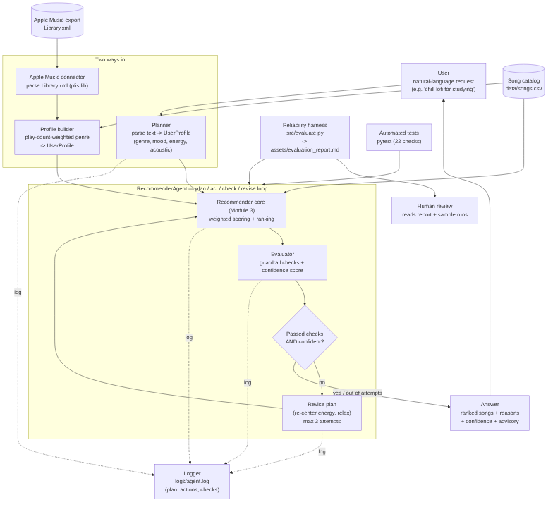

# 🎧 VibeFinder Agent — a self-checking music recommender

An applied-AI system that takes a plain-English request like *"chill lofi
for studying"* and returns a ranked playlist **with reasons, a confidence
score, and a record of how it checked its own work.**

> **Base project (Modules 1–3):** this extends my Module 3 **Music
> Recommender Simulation** ([VibeFinder 1.0](#)). That project represented
> songs and a user "taste profile" as data and used a weighted scoring
> rule (+2 genre, +1 mood, energy-similarity, acoustic bonus) to rank and
> explain song recommendations from a fixed profile. This Module 5 version
> keeps that scoring core and wraps it in an **agentic workflow** that
> understands natural language, tests itself, and handles bad input safely.

---

## What it does and why it matters

The Module 3 version needed a hand-built profile object and always trusted
its own output. Real recommender front-ends take messy human input and
have to know when they might be wrong. VibeFinder Agent adds exactly that:
a planning step that reads free text, and a self-evaluation step that
scores its own confidence and retries when it falls short — the difference
between a scoring function and a small *system*.

**Advanced AI feature (required):** this project implements an **Agentic
Workflow** — the system plans, acts, and checks its own work — and backs
it with **confidence scoring** and an automated **reliability/testing**
harness. The agent loop is the main application logic, not a bolt-on: the
retrieved/parsed intent and the self-check actually change which songs are
returned (see the "some jazz" example below, where the agent revises its
plan and re-ranks).

**Apple Music integration:** instead of typing a request, you can point
the agent at a library exported from the macOS Music app
(`--library Library.xml`). It reads your real listening history — weighting
genres by play count — and builds your taste profile automatically, then
runs the same self-checking loop. It uses the Music app's **Export Library**
XML parsed with the standard-library `plistlib`, so there is **no API key,
no paid Apple Developer account, and nothing leaves your machine** (the
live MusicKit API needs a $99/yr token; Spotify removed the audio-feature
endpoints a recommender needs). A small synthetic `data/sample_library.xml`
is included so the feature runs out of the box.

---

## Architecture Overview



*(Mermaid source: [`diagrams/architecture.mmd`](diagrams/architecture.mmd).)*

There are **two ways in** — a typed request or an Apple Music library —
and both feed the same **plan → act → check → revise** loop:

0. **Apple Music connector + profile builder** (`src/connectors/apple_music.py`,
   `src/profile_builder.py`) — optional input path: parse an exported
   `Library.xml` and infer a `UserProfile` from play-count-weighted genres.
1. **Planner** (`src/planner.py`) — the text path: parses a natural-language
   request into a `UserProfile` (genre, mood, energy, acoustic). Rule-based,
   so it's reproducible and free to run.
2. **Recommender core** (`src/recommender.py`) — the unchanged Module 3
   engine: scores every song in `data/songs.csv` and ranks them.
3. **Evaluator** (`src/evaluator.py`) — runs guardrail checks (non-empty,
   right length, sorted, genre honored) and computes a 0–1 **confidence**
   score against a perfect match.
4. **Revise** — if the check fails, the agent adjusts the plan (e.g.
   re-centers target energy onto the real songs when the user gave no
   energy cue) and tries again, up to 3 attempts.
5. **Logger** (`logs/agent.log`) records every plan, action, and check.

The **reliability harness** (`src/evaluate.py`), the **pytest** suite, and
**human review** of the reports all sit outside the loop and verify it.

---

## Setup

Requires Python 3.9+ and the standard library; `pytest` is the only
dependency.

```bash
# 1. clone, then from the repo root:
python -m venv .venv
source .venv/bin/activate        # Windows: .venv\Scripts\activate
pip install -r requirements.txt

# 2. ask for a recommendation
python -m src.main "chill lofi for studying"

# 3. or run the built-in sample requests
python -m src.main

# 4. or use an Apple Music library export (sample file included)
python -m src.main --library data/sample_library.xml
#    on a Mac, export your own first: Music -> File -> Library -> Export Library...

# 5. run the reliability harness (writes assets/evaluation_report.md)
python -m src.evaluate

# 6. run the tests
pytest
```

---

## Sample Interactions

**1. A clear request — high confidence, one attempt:**

```text
Request: "upbeat pop for a workout"
  understood as: genre=pop, mood=happy, energy=0.9, acoustic=False
  confidence: 0.88   attempts: 1   passed checks: True
----------------------------------------------------------------
1. Sunrise City by Neon Echo  (score 4.38)
   because: genre match: pop (+2.0); mood match: happy (+1.0); energy fits (gap 0.08, +1.38)
2. Pop Quiz by Max Pulse  (score 4.33)
   because: genre match: pop (+2.0); mood match: happy (+1.0); energy fits (gap 0.11, +1.33)
3. Gym Hero by Max Pulse  (score 3.46)
   because: genre match: pop (+2.0); energy fits (gap 0.03, +1.46)
```

**2. A request the agent self-corrects** — no energy was given, so the
first attempt is under-confident; the agent re-centers energy and retries:

```text
Request: "some jazz"
  understood as: genre=jazz, mood=-, energy=0.35, acoustic=False
  confidence: 0.69   attempts: 2   passed checks: True
----------------------------------------------------------------
1. Coffee Shop Stories by Slow Stereo  (score 3.47)
   because: genre match: jazz (+2.0); energy fits (gap 0.02, +1.47)
2. Grandma's Record Player by Slow Stereo  (score 3.47)
   because: genre match: jazz (+2.0); energy fits (gap 0.02, +1.47)
  trace:
    - Attempt 1: top='Coffee Shop Stories' confidence=0.63 passed=False issues=['low confidence 0.63 (< 0.65)']
    - Revise: no energy given, re-centering target energy 0.6 -> 0.35 (mean of matching songs) and retrying.
    - Attempt 2: top='Coffee Shop Stories' confidence=0.69 passed=True
```

**3. Apple Music library — profile built from listening history:**

```text
Request: "Apple Music library (sample_library.xml, 8 tracks)"
  understood as: genre=pop, mood=-, energy=0.85, acoustic=False
  confidence: 0.69   attempts: 1   passed checks: True
----------------------------------------------------------------
1. Sunrise City by Neon Echo  (score 3.46)
   because: genre match: pop (+2.0); energy fits (gap 0.03, +1.46)
2. Pop Quiz by Max Pulse  (score 3.41)
   because: genre match: pop (+2.0); energy fits (gap 0.06, +1.41)
  trace:
    - Plan: Analyzed 8 tracks...; Plays by genre: pop=163, indie pop=41, jazz=33,
      hip hop=27, rock=19, r&b=14.; Top genre by play count -> 'pop'.;
      Target energy -> 0.85 (average energy of pop songs in the catalog).
```

**4. Vague input — handled safely, not crashed:**

```text
Request: "asdf qwerty"
  understood as: genre=-, mood=-, energy=0.6, acoustic=False
  confidence: 0.29   attempts: 1   passed checks: False
  note: Your request was vague, so this is a neutral mix. Name a genre,
        mood, or vibe (e.g. 'chill lofi for studying') for a sharper match.
```

More captured output is in [`assets/sample_run.txt`](assets/sample_run.txt)
and a full self-correction log in
[`assets/sample_agent_log.txt`](assets/sample_agent_log.txt).

---

## Design Decisions and Trade-offs

- **Rule-based planner instead of an LLM call.** The planner maps keywords
  to profile fields rather than calling a language model. **Trade-off:** it
  only understands a fixed vocabulary, but the whole system is free,
  offline, deterministic, and reproducible by a grader with no API key —
  which matters more for this project than handling arbitrary phrasing.
- **Reused the Module 3 scoring core untouched.** The agent wraps the
  original recommender rather than rewriting it, so the earlier work stays
  intact and the new value is clearly the agentic layer.
- **Confidence against a fixed "perfect match" ceiling.** This makes a
  vague request honestly score low instead of looking falsely certain.
  **Trade-off:** a request that omits genre can't reach high confidence
  even if the songs are reasonable — which is the behavior I wanted.
- **Revision = re-centering energy, with a hard 3-attempt cap.** A bounded,
  explainable fix beats an open-ended search. **Trade-off:** it won't
  rescue a genuinely unanswerable request; it flags low confidence instead.

---

## Testing Summary

- **Automated tests:** `pytest` → **22/22 passing**, covering the scoring
  core, natural-language parsing, the guardrail/confidence checks, the
  agent's retry-based self-correction, empty-input handling, the retry cap,
  and the Apple Music connector (parsing, genre mapping, profile building,
  empty-library fallback).
- **Reliability harness:** `python -m src.evaluate` runs 8 requests
  (including empty and nonsense edge cases) → **8/8 handled correctly**,
  **1 solved only after a self-correcting retry**, average confidence
  **0.74** (excluding empty input). Full table:
  [`assets/evaluation_report.md`](assets/evaluation_report.md).
- **What I learned:** the system is strong on clear requests and degrades
  honestly on vague ones. The weak spot is the planner's fixed vocabulary —
  a synonym it doesn't know (e.g. "hype music") is silently missed. The
  confidence score and advisory are what keep that failure visible instead
  of hidden.

---

## Reflection

Extending the recommender taught me that the jump from a *function* to a
*system* is mostly about humility: the new code is almost entirely about
the program knowing when it might be wrong and saying so. The hardest part
wasn't the recommendations — that was Module 3 — it was designing a
confidence number and a retry that were honest rather than flattering.

> My graded responsible-AI reflection — how I worked with AI, one
> suggestion I accepted and one I rejected, bias, and limitations — is in
> [`model_card.md`](model_card.md), as the rubric requires.
